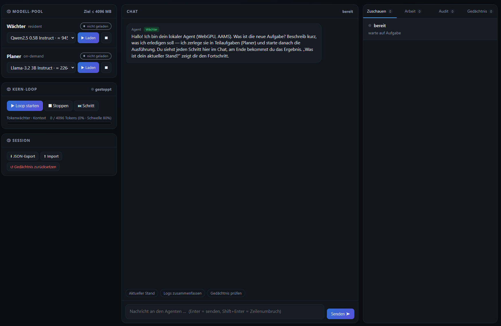

# webgpu-agent

**Local-First WebGPU Agent** — ein vollständig clientseitiger, autonomer Webagent im Browser.
AAMS als **natives Gedächtnis** (AAMS-Doppelrolle) + **WebLLM** (WebGPU) für lokale Inferenz.
Keine Cloud, keine Serverinfrastruktur → maximale Datensouveränität.

> **Architektur & Fundament:** `WORKING/WHITEPAPER/WH-001-ARCH-webgpu-single-agent-prototype.md`
> **Benchmark-System (Level 1–10, ≤ 4 GB VRAM):** `WORKING/WHITEPAPER/WH-002-BENCH-benchmark-levels-webgpu.md`
> **Dev-Prozess:** `READ-AGENT.md` + `.agent.json` (AAMS/2.6.0)



## Projekt-Natur (WIP / Experiment)

> **Dies ist ein privates Forschungsprojekt und Experiment — Work in Progress (WIP).**
> Kein Produkt, keine Support- oder Stabilitätsversprechen; Architektur und API können sich ändern.
> Der Entwicklungsprozess ist bewusst im Repo dokumentiert (Whitepapers `WORKING/WHITEPAPER/`,
> Workpapers `WORKING/WORKPAPER/`).
>
> **Mitarbeit ist ausdrücklich erwünscht** — Feedback, Issues, Pull Requests willkommen
> (siehe [Mitarbeit](#mithilfe)).
>
> **Lizenz:** MIT (siehe [Lizenz](#lizenz)).

## Status
**Prototyp** (Vite + TypeScript). Kernpfade + **echter Agent-Loop**:
AAMS(B)-Store (IndexedDB) · Task-Queue · **Modell-Pool** (Wächter resident + Planer on-demand,
Auswahl + Download-Fortschritt in der UI) · **echte Zerlegung** (Planer-JSON) + **echte Ausführung**
(Executor-Regel, echte Token-Usage) · **Chat als einziger Dialogkanal** (`Agent.chat()`, Wächter =
Stimme, Intent status/task/frage) · KERN-Prototyp (Tokenwächter, simuliert) · Gedächtnis-Reset.
**Dashboard (WP-UI-DASH):** dunkler App-Frame (3 Spalten) · Wächter-/Planer-Karten (Stufen/%/Tempo/ETA
+ DEGRADED) · VRAM-Bar in Topbar · Tabs **Zuschauen** (Live-Feed + „Gerade“-Karte) / **Arbeit**
(Task-Tree) / **Audit** (filterbar) / **Gedächtnis** (kind+tags) · Browser-Checkliste noch offen.
**Benchmark-System** (Level 1–10) ist als `WH-002` fixiert; erste Testläufe + Benchmark-Seite folgen.

## Start
```bash
npm install
npm run dev        # → http://localhost:5173
npm run build      # → dist/ (relativ, läuft auch statisch)
npm run typecheck  # tsc --noEmit
```

> **WebGPU-Voraussetzung:** aktueller Browser mit WebGPU (Chrome/Edge).
> Die WebLLM-Weights werden beim ersten `load()` lazy geladen (siehe `src/llm/webllm.ts`).

## Features
- **AAMS(B)-Session** in IndexedDB: `session` + `tasks` (Task-Tree) + `auditLog` + `memory` + `knowledge`
- **Task-Queue:** Sub-Tasks mit Status `pending / in_progress / done`
- **Chat (einziger Textkanal, WP-UI-DASH):** Intent-gesteuert — Status (Template) · „beginne“/„start“
  → **Ausführung** (`runAll()`) · Aufgabe → **Planer zerlegt → automatisch Ausführung** (autonomer
  Loop) · Frage → **Planer antwortet** (on-demand, danach entladen) · Rollen-Badges, Typing-Indikator, Chips
  · **Workflow + Ergebnis im Chat** (Plan-Zeile, `⏳ i/n`/`✓`/`✗` je Schritt, Abschluss mit Ergebnis
  je Task — Volltext im Tab „Arbeit“)
- **Modell-Pool (Karte ①):** Wächter resident + Planer on-demand · **Modell-Auswahl** (Katalog ≤ 4 GB) +
  **Laden/Entladen** + **Download-Fortschritt** (Stufen/Balken/%/Tempo/Restzeit/Raw) · **DEGRADED**-State ·
  **VRAM-Budget-Balken** (2 Segmente) in der Topbar
- **Zuschauen (Tab):** „Gerade“-Karte (Aktion + Modell + Laufzeit) + farbcodierter Live-Feed (llm/task/guard/session)
- **Echter Agent-Loop:** Zerlegung via **Planer-JSON** → Task-Tree · Ausführung mit **Executor-Regel**
  (Teilaufgabe→Planer, Wurzel→Wächter) · **echte Token-Usage** + Audit-Spur (`llm.*`, `plan.*`, `chat.*`)
- **Artefakt (V4 Schritt 1):** HTML-Ergebnisse werden als **echte Dateien** abgeleitet (kein Schema-Eingriff) —
  **Sandbox-Vorschau** (iframe ohne `allow-same-origin`) + **Download** im Tab „Arbeit" · Audit `artifact.ready/preview/download`
- **Gedächtnis-Reset:** „Neue Session" komplett & sauber — automatischer Safety-Export, Audit-Spur (`session.reset`), Rollback bei Speicherfehler (idee.md §3A)
- **JSON-Export/Import:** Portabilität + Backup/Restore (keine Cloud, Import mit Schema-Prüfung)
- **WebLLM-Adapter (lazy):** WebGPU-Inferenz, austauschbar via `LLMEngine`-Interface

## Struktur
```
src/
├── aams/     # AAMS(B): Schema, Store (IndexedDB), JSON-IO, Reset   ← Herzstück (Doppelrolle)
├── agent/    # Agent-Core (chat(), Planer-JSON, Executor-Regel), Task-Queue
├── artifact/ # V4 Schritt 1: HTML-Artefakt (Extraktion aus task.result + Download)
├── kern/     # KERN-Prototyp: Tokenwächter + mechanischer Loop
├── llm/      # LLMEngine-Interface, WebLLM-Adapter (lazy), Katalog + Modell-Pool (stageFromText)
└── ui/       # WP-UI-DASH: theme.css (Design-Tokens) · api.ts (WGA-Adapter) · wire.ts (Controls)
```

## Deploy (Beispiel & Forschung)

> **⚠ Status: BEISPIEL & FORSCHUNG — kein verbindlicher Plan.**
>
> **Erster Deploy (2026-10-17) — ✅ LIVE:**
> **Demo:** `https://huggingface.co/spaces/ogerl/webgpu-agent` (HuggingFace-Static-Space,
> App läuft in der Space-Seite) ·
> **Doku:** `https://ogerl-webgpu-agent.static.hf.space/dokumentation.html` (Warum/Ziel/Stand/Forschungsansatz/
> Offene Probleme/Wächter-Modell — Quelle: `website/dokumentation.html`) ·
> **Code:** `https://github.com/ogerly/webgpu-agent` (GitHub = **nur Code** — **kein Pages, kein Actions**).
> `dist/` (6 MB) als HuggingFace-Static-Space hochgeladen; index.html + JS + CSS verifiziert (HTTP 200,
> JS byte-identisch zum lokalen Build). Details: `WORKING/WORKPAPER/WP-2026-10-17-DEPLOY-webgpu-agent-deploy-optionen.md` §4.
>
> Der Agent läuft 100 % clientseitig: „Deploy" = **statische App + Modelle an die Browser
> liefern** (kein Backend). Optionen (lokaler Server, statisches Hosting, PWA, selbst gehostete
> Weights) und offene Forschungsfragen (Offline nach Setup, AAMS-B-Gedächtnis **pro
> Browser/Origin**, WebGPU-Verfügbarkeit, Modell-Updates) stehen im Workpaper:
> `WORKING/WORKPAPER/WP-2026-10-17-DEPLOY-webgpu-agent-deploy-optionen.md`
>
> Hinweis: Weights (≈ 945 MB Wächter / ≈ 2,3 GB Planer) werden beim ersten Laden vom CDN
> heruntergeladen (Setup) · WebGPU-Pflicht: Chrome/Edge.
>
> Schnellstart (lokal): `npm run build` → `npx serve dist -l 8080` → Chrome/Edge mit WebGPU.

## Mitarbeit

- **Feedback/Ideen:** Issues auf GitHub — `https://github.com/ogerly/webgpu-agent`
- **Code:** Fork → Branch → Pull Request; `npm run typecheck` + `npm run build` müssen grün bleiben.
- **Kontext zuerst lesen:** `READ-AGENT.md` (Einordnung) · `idee.md` (Vision) ·
  `WORKING/WHITEPAPER/` (Architektur-Wahrheit) · `WORKING/WORKPAPER/` (offene Aufgaben/Forschung).
- **Tonalität:** ehrlich über den WIP-Status — keine fertigen „Features" versprechen.

## Lizenz

**MIT** — Details in [`LICENSE`](LICENSE).
Hinweis: Die **Modell-Weights** (Qwen/Llama via WebLLM/MLC-Web-CDN) unterliegen ihren eigenen
Lizenzen und sind nicht Teil dieses Repos.

## Nächste Schritte (→ Workpaper `next_steps` + `WH-002`)
- [x] LLM-gestützte **Task-Zerlegung** (Planer) + echte **Ausführung** im Loop
- [x] **Dashboard (WP-UI-DASH):** Chat = einziger Textkanal · Wächter-/Planer-Karten · VRAM-Bar ·
      Tabs Zuschauen/Arbeit/Audit/Gedächtnis · **Browser-Test noch offen** (Checkliste im WP)
- [ ] **Benchmark-Seite:** Szenario-Textseiten L1–L5 + Start + Run-Report (`src/bench/*`)
- [ ] **Panel „Maschine“:** WebGPU/CPU/RAM/Speicher + MachineProfile (Reproduzierbarkeit)
- [ ] **Erster Testlauf:** L1 × 3 Kategorien × 5 Runs → WH-002 „bewiesen“-Standard (5/5)
- [ ] **Helfer-Modelle** (OCR / Translation / Web-Fetch) via Transformers.js, on-demand, VRAM danach frei
- [ ] **Tests** (Vitest) für `aams/*` + `task-queue` + `llm/pool`
- [ ] Auto-Loop-Timer (15–30 min) / manuelle Auslösung (idee.md §3B)
